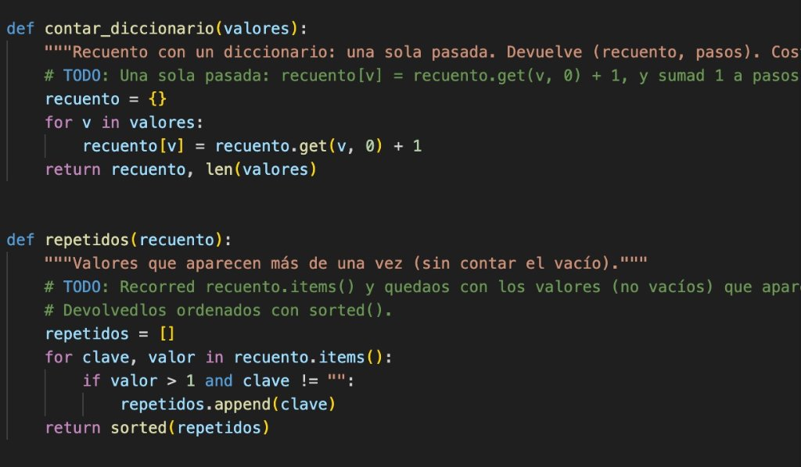
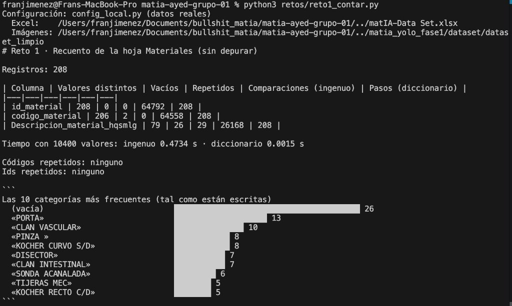

# Informe del Reto 1 · Recuento eficiente de la hoja «Materiales»

> **Proyecto:** MatIA · Datos de instrumental quirúrgico con Python y Bash
> **Asignatura:** Algoritmos y Estructura de Datos · 2.º Grado en Computación e Inteligencia Artificial · UAX Mare Nostrum · ULAB MatIA
> **Grupo:** Grupo 01
> **Integrantes:** Pablo Picón, Francisco Jiménez y Giovanni Giove

---

## 1. Objetivo del Reto 1

El propósito del Reto 1 es contabilizar —todavía **sin depurar**— cuántas veces aparece cada identificador (`id_material`), cada código de fabricante (`codigo_material`) y cada categoría descriptiva (`Descripcion_material_hqsmlg`) en la hoja **«Materiales»** del Excel de inventario quirúrgico.

Más allá del recuento en sí, el reto persigue demostrar empíricamente el impacto de elegir la estructura de datos adecuada, comparando:

1. **Algoritmo ingenuo (`contar_ingenuo`, ya proporcionado):** utiliza listas y recorre la colección completa por cada valor distinto, con un coste aproximado de $O(n \cdot k)$ comparaciones (donde $n$ es el número de registros y $k$ el número de valores distintos).
2. **Algoritmo con diccionario (`contar_diccionario`, a implementar):** realiza el recuento en **una sola pasada** aprovechando el acceso en tiempo constante promedio de las tablas hash (`dict`), con un coste lineal de $O(n)$ pasos.
3. **Detección de duplicados (`repetidos`, a implementar):** identifica los valores no vacíos que aparecen más de una vez y los devuelve ordenados alfabéticamente.

---

## 2. Qué se esperaba obtener

De acuerdo con [`docs/RETOS.md`](../RETOS.md), el reto establece dos niveles de verificación:

### 2.1. Pruebas unitarias (`assert`) y datos de ejemplo

Antes de ejecutar sobre los datos reales, el código debe superar las pruebas automáticas de `pruebas()` (caso presente, ausente, vacío, equivalencia entre ambos algoritmos y filtrado de repetidos) y producir sobre `datos_ejemplo/ejemplo_matia.xlsx` (19 registros):

| Columna (`datos_ejemplo`) | Valores distintos | Vacíos |   Repetidos   | Comparaciones (ingenuo) | Pasos (diccionario) |
| :-------------------------- | :---------------: | :-----: | :------------: | :---------------------: | :-----------------: |
| `id_material`             |        18        |    0    | 1 (`ej013`) |           508           |         19         |
| `codigo_material`         |        17        |    1    | 1 (`QF200R`) |           —           |         19         |

### 2.2. Cuestiones a responder con los datos reales

Con la tabla real configurada mediante `config_local.py`, se esperaba:

- Verificar que ambos algoritmos producen exactamente el mismo recuento (`assert r_ing == r_dic`).
- Medir el número de comparaciones del método ingenuo frente a los pasos del diccionario.
- Cuantificar la diferencia de tiempo de ejecución al escalar los datos ($\times 50$).
- Analizar qué duplicados o anomalías iniciales afloran antes de la fase de depuración (Reto 2).

---

## 3. Implementación realizada

A continuación se muestra el código desarrollado por el equipo para las funciones `contar_diccionario` y `repetidos` dentro de `retos/reto1_contar.py`:

### Detalles de diseño

- **`contar_diccionario(valores)`:** recorre `valores` una única vez acumulando cada frecuencia mediante `recuento[v] = recuento.get(v, 0) + 1`, y devuelve `(recuento, len(valores))`, reflejando exactamente $n$ pasos.
- **`repetidos(recuento)`:** itera sobre `recuento.items()`, filtra las claves con frecuencia estrictamente mayor que 1 y distintas de la cadena vacía (`""`), y devuelve la lista resultante ordenada con `sorted()`.

---

## 4. Resultados obtenidos con los datos reales

Al ejecutar `python3 retos/reto1_contar.py` apuntando al conjunto de datos real del hospital (`config_local.py`), todas las pruebas (`assert`) se superaron correctamente y se obtuvo la siguiente salida:

### 4.1. Resumen cuantitativo (208 registros)

| Columna                         | Valores distintos | Vacíos | Repetidos | Comparaciones (ingenuo) | Pasos (diccionario) |    Reducción de operaciones    |
| :------------------------------ | :---------------: | :-----: | :-------: | :---------------------: | :-----------------: | :-----------------------------: |
| `id_material`                 |        208        |    0    |     0     |         64.792         |         208         | $\approx 311{,}5\times$ menos |
| `codigo_material`             |        206        |    2    |     0     |         64.558         |         208         | $\approx 310{,}4\times$ menos |
| `Descripcion_material_hqsmlg` |        79        |   26   |    29    |         26.168         |         208         | $\approx 125{,}8\times$ menos |

- **Códigos repetidos:** ninguno.
- **IDs repetidos:** ninguno.

### 4.2. Rendimiento temporal (10.400 valores)

Al repetir la columna `codigo_material` 50 veces ($208 \times 50 = 10.400$ valores):

| Algoritmo                           | Tiempo de ejecución |   Complejidad   |
| :---------------------------------- | :------------------: | :--------------: |
| Recuento ingenuo (listas)           |     `0.4734 s`     | $O(n \cdot k)$ |
| Recuento con diccionario (`dict`) |     `0.0015 s`     |     $O(n)$     |

> **Conclusión de rendimiento:** el algoritmo con diccionario resultó aproximadamente **315,6 veces más rápido** que el enfoque ingenuo ($0{,}4734 / 0{,}0015 \approx 315{,}6$).

### 4.3. Top 10 categorías más frecuentes (sin depurar)

| Posición | Categoría (tal como figura en el Excel) | Frecuencia |
| :-------: | :--------------------------------------- | :--------: |
|     1     | `(vacía)`                             |     26     |
|     2     | `«PORTA»`                            |     13     |
|     3     | `«CLAN VASCULAR»`                    |     10     |
|     4     | `«PINZA »`                           |     8     |
|     5     | `«KOCHER CURVO S/D»`                 |     8     |
|     6     | `«DISECTOR»`                         |     7     |
|     7     | `«CLAN INTESTINAL»`                  |     7     |
|     8     | `«SONDA ACANALADA»`                  |     6     |
|     9     | `«TIJERAS MEC»`                      |     5     |
|    10    | `«KOCHER RECTO C/D»`                 |     5     |

---

## 5. Análisis y respuestas a las cuestiones del informe

1. **¿Cuántas comparaciones hace cada algoritmo con la tabla real?**Con los 208 registros reales, el algoritmo ingenuo realiza **64.792 comparaciones** en `id_material`, **64.558** en `codigo_material` y **26.168** en `Descripcion_material_hqsmlg`. Por el contrario, el algoritmo con diccionario realiza siempre exactamente **208 pasos** en las tres columnas, con independencia de cuántos valores distintos existan.
2. **¿Cuánto más rápido es el diccionario?**En la prueba de rendimiento con 10.400 elementos, el diccionario tarda `0.0015 s` frente a los `0.4734 s` del algoritmo ingenuo, lo que supone una aceleración de **~315,6 veces**.
3. **¿Por qué hay categorías «repetidas» que no son un error?**A diferencia de `id_material` o `codigo_material` —que identifican de forma única a cada referencia del inventario y, por tanto, no deberían repetirse—, la columna `Descripcion_material_hqsmlg` agrupa el instrumental por **tipo o categoría**. Es completamente normal que existan múltiples piezas distintas (con diferente `id_material` y `codigo_material`, por ejemplo por tamaño o fabricante) que pertenezcan a la misma categoría, como los 13 portaagujas (`«PORTA»`) o los 8 `«KOCHER CURVO S/D»`.
4. **Hallazgos preliminares sobre la calidad de los datos (antes de depurar):**

   - Existen **2 registros** sin `codigo_material` y **26 registros** sin categoría (`(vacía)`), que de hecho constituye el valor más frecuente de la columna descriptiva.
   - Se aprecian ya indicios claros de falta de normalización y erratas que se abordarán en el Reto 2: espacios sobrantes al final (`«PINZA »`) y posibles erratas tipográficas (`«CLAN VASCULAR»` / `«CLAN INTESTINAL»` en lugar de *CLAMP*).

---

## 6. Conclusión

El Reto 1 se ha completado satisfactoriamente: las funciones `contar_diccionario` y `repetidos` pasan todas las pruebas unitarias y coinciden exactamente con el algoritmo de referencia sobre los datos reales. Además de confirmar la ausencia de duplicados en identificadores y códigos, el experimento demuestra de forma clara la ventaja de pasar de un coste cuadrático/bilineal $O(n \cdot k)$ a un coste lineal $O(n)$ mediante el uso de diccionarios en Python.
