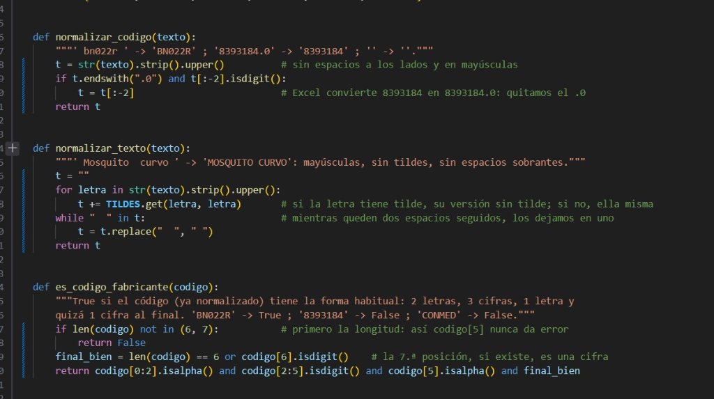
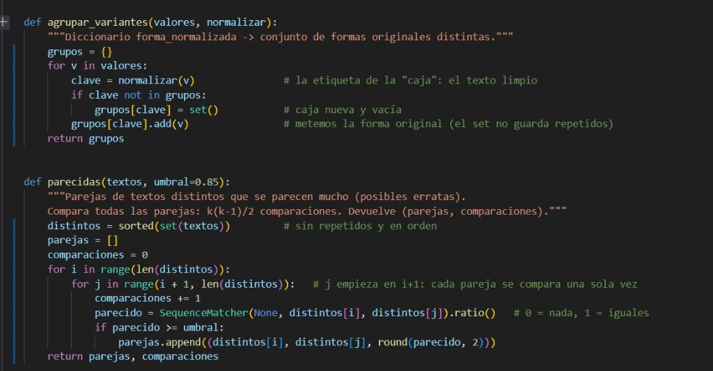

# Informe del Reto 2 · Depuración, normalización y detección de erratas

> **Proyecto:** MatIA · Datos de instrumental quirúrgico con Python y Bash  
> **Asignatura:** Algoritmos y Estructura de Datos · 2.º Grado en Computación e Inteligencia Artificial · UAX Mare Nostrum · ULAB MatIA  
> **Grupo:** Grupo 01  
> **Integrantes:** Pablo Picón, Francisco Jiménez y Giovanni Giove  
> **Archivos analizados:** `herramienta/normalizar.py` y `retos/reto2_depurar.py`

---

## 1. Objetivo del Reto 2

En el Reto 1 se comprobó que contar datos sin depurar puede distorsionar el inventario debido a espacios sobrantes, diferencias de mayúsculas/minúsculas, tildes o erratas tipográficas. El Reto 2 tiene como objetivo construir una capa de **normalización y detección de anomalías** antes de realizar recuentos y cruces definitivos:

1. **Normalización (`herramienta/normalizar.py`):**
   - `normalizar_codigo(texto)`: elimina espacios laterales, convierte a mayúsculas y retira el sufijo `.0` que Excel añade a los códigos numéricos.
   - `normalizar_texto(texto)`: elimina espacios sobrantes (laterales e internos duplicados), convierte a mayúsculas y retira las tildes.
   - `es_codigo_fabricante(codigo)`: comprueba si un código normalizado sigue el patrón habitual de fabricante (`2 letras + 3 cifras + 1 letra + cifra opcional`).
2. **Análisis de variantes y similitud (`retos/reto2_depurar.py`):**
   - `agrupar_variantes(valores, normalizar)`: agrupa en un diccionario de conjuntos qué formas originales distintas colapsan en la misma forma normalizada.
   - `parecidas(textos, umbral=0.85)`: compara todas las parejas de textos distintos mediante `SequenceMatcher(None, a, b).ratio()` y devuelve aquellas cuyo parecido supera el umbral, contabilizando el número exacto de comparaciones.

---

## 2. Qué se esperaba obtener

Según [`docs/RETOS.md`](../RETOS.md), el código debe superar primero las pruebas unitarias (`assert`) y producir sobre `datos_ejemplo/ejemplo_matia.xlsx`:

- **Códigos que cambian al normalizar:** `QC102R` (espacio sobrante) y `QH110R` (minúsculas).
- **Categorías distintas:** `16` antes de normalizar y `14` después.
- **Variantes agrupadas:** `MOSQUITO CURVO` y `PINZA DISECCION`.
- **Parejas parecidas:** `CLAMP VASCULAR`–`CLAN VASCULAR` (`0,89`) y `TIJERA MAYO CURVA`–`TIJERAS MAYO CURVA` (`0,97`).
- **Códigos con formato distinto del habitual:** `8393184`.
- **Descripciones repetidas:** `ej006` y `ej009`.

Sobre los **datos reales** (`config_local.py`), el objetivo es identificar qué códigos y categorías cambian, detectar formatos no estándar y clasificar manualmente las parejas parecidas propuestas por la herramienta.

---

## 3. Implementación realizada

### 3.1. Módulo de normalización (`herramienta/normalizar.py`)

### 3.2. Agrupación de variantes y detección de parecidas (`retos/reto2_depurar.py`)

---

## 4. Resultados obtenidos con los datos reales

Al ejecutar `python retos/reto2_depurar.py` sobre el conjunto real (`matIA-Data Set.xlsx`, 208 registros), se obtuvieron los siguientes resultados:

### 4.1. Comparativa antes y después de normalizar

| Indicador | Antes | Después de normalizar |
| :--- | :---: | :---: |
| Códigos distintos (sin vacíos) | 206 | 206 |
| Códigos vacíos | 2 | 2 |
| Códigos repetidos | 0 | 0 |
| Categorías distintas | 79 | 79 |
| Materiales sin categoría | 26 | 26 |

### 4.2. Códigos modificados y formatos atípicos

- **Códigos que cambian al normalizar (1):**
  - `matcg000108`: `'BN012R '` $\rightarrow$ `BN012R` (espacio final sobrante).
- **Códigos repetidos tras normalizar:** ninguno.
- **Códigos con formato distinto del habitual (15):**  
  `1-1010 202210171`, `40653405059-319`, `40653405059-333`, `40653405059-401`, `40653405059-456`, `83930072`, `83930074`, `8393184`, `8393191`, `8393933`, `8394184`, `8394933`, `CONMED`, `RU4580-40`, `SRNH1`.
- **Categorías diferenciadas solo por espacios, mayúsculas o tildes:** ninguna (`0` fusiones).
- **Descripciones repetidas (1):**
  - `PINZA AGARRE LAPAROSCOPICA`: `matcg000010`, `matcg000013`.

### 4.3. Categorías parecidas detectadas (3.081 comparaciones, umbral $\ge 0{,}85$)

| Categoría | Categoría parecida | Parecido (0–1) | Valoración preliminar |
| :--- | :--- | :---: | :--- |
| `ADSON C/D` | `ADSON S/D` | `0.89` | Instrumentos distintos (con/sin dientes) |
| `DISECCION C/D` | `DISECCION S/D` | `0.92` | Instrumentos distintos (con/sin dientes) |
| `DISECTOR BABY-MIXTER` | `DISECTOR MIXTER` | `0.86` | Instrumentos distintos (tamaño *baby* vs estándar) |
| `KOCHER RECTO C/D` | `KOCHER RECTO S/D` | `0.94` | Instrumentos distintos (con/sin dientes) |
| `KOTCHER RECTO MED` | `KOTCHER RECTO PEQ` | `0.88` | Instrumentos distintos (mediano vs pequeño) |
| `MANGO BISTURI 3` | `MANGO BISTURI 4` | `0.93` | Instrumentos distintos (calibre 3 vs 4) |
| `MANGO BISTURI 3` | `MANGO BISTURI 4L` | `0.90` | Instrumentos distintos (calibre/longitud) |
| `MANGO BISTURI 4` | `MANGO BISTURI 4L` | `0.97` | Instrumentos distintos (estándar vs largo) |
| `PINZA BAKEY` | `PINZA DE BAKEY` | `0.88` | Probable variante de escritura (mismo instrumento) |
| `PINZA DISECCION C/D` | `PINZA DISECCION S/D` | `0.95` | Instrumentos distintos (con/sin dientes) |
| `TIJERA MAC` | `TIJERA MAR` | `0.90` | Ambiguo (requiere validación clínica) |
| `TIJERA MAC` | `TIJERA MEC` | `0.90` | Ambiguo (requiere validación clínica) |
| `TIJERA MAC` | `TIJERAS MAR` | `0.86` | Ambiguo (requiere validación clínica) |
| `TIJERA MAC` | `TIJERAS MEC` | `0.86` | Ambiguo (requiere validación clínica) |
| `TIJERA MAR` | `TIJERAS MAR` | `0.95` | Probable variante singular/plural |
| `TIJERA MEC` | `TIJERAS MEC` | `0.95` | Probable variante singular/plural |

---

## 5. Respuestas a las cuestiones del informe

1. **¿Qué parejas parecidas son erratas y cuáles son instrumentos distintos?**
   - **Instrumentos claramente distintos (9 parejas):** todas las parejas que difieren en `C/D` vs `S/D` (*con dientes* / *sin dientes*), en el tamaño (`MED` vs `PEQ`, `BABY-MIXTER` vs `MIXTER`) o en el número/longitud del mango de bisturí (`3`, `4`, `4L`). Aunque su similitud textual alcanza hasta `0.97`, representan piezas quirúrgicas funcionalmente distintas y **no deben fusionarse**.
   - **Variantes de escritura / erratas claras (3 parejas):** `PINZA BAKEY` / `PINZA DE BAKEY` (omisión de preposición), `TIJERA MAR` / `TIJERAS MAR` y `TIJERA MEC` / `TIJERAS MEC` (inconsistencia singular/plural).
   - **Casos ambiguos (4 parejas):** las combinaciones entre `TIJERA(S) MAC`, `MAR` y `MEC`, donde una sola letra puede corresponder tanto a una errata de teclado como a abreviaturas de modelos distintos.

2. **¿Quién debe decidirlo?**  
   La herramienta **propone** candidatas, pero la decisión final nunca debe automatizarse sin supervisión: corresponde al **personal clínico / servicio de esterilización del hospital** (o al responsable de catálogo del proyecto MatIA), que conoce la nomenclatura real del instrumental.

3. **¿Qué erratas no puede encontrar este método?**
   - **Erratas sistemáticas sin forma correcta en la tabla:** si una palabra está mal escrita en todas sus apariciones (por ejemplo, `CLAN VASCULAR` si no existe `CLAMP VASCULAR` en la tabla), no hay pareja con la que compararla.
   - **Erratas por debajo del umbral (`< 0.85`):** palabras cortas donde un cambio de 1–2 letras hace caer el `ratio()` por debajo de `0.85`, o abreviaturas muy diferentes del nombre completo (por ejemplo, `PORTA` frente a `PORTAAGUJAS`).
   - **Errores semánticos:** asignar una categoría válida pero equivocada a un instrumento (por ejemplo, etiquetar una pinza como tijera).

---

## 6. Conclusión

El Reto 2 se ha completado correctamente: la normalización corrige el código `'BN012R '` sin generar colisiones, identifica **15 códigos fuera del formato estándar**, detecta **1 descripción duplicada** (`PINZA AGARRE LAPAROSCOPICA`) y extrae **16 parejas parecidas** tras 3.081 comparaciones, dejando claro por qué la revisión humana sigue siendo indispensable antes de unificar categorías.
